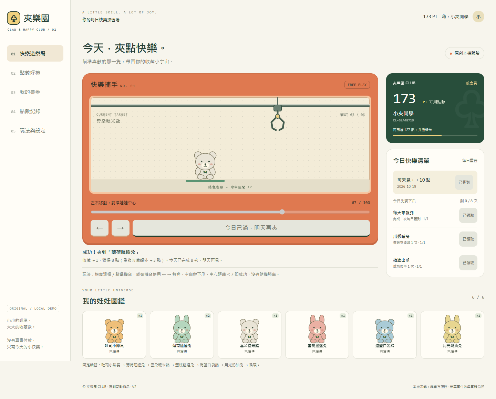

# 夾樂園 CLUB

單檔互動會員 Web App：技巧型夾娃娃、收藏圖鑑、每日任務與點數兌換票券。

## 開始使用

開啟 `index.html`，或使用本儲存庫的 GitHub Pages 網站。

1. 輸入暱稱建立本機體驗會員。
2. 每日簽到、完成任務並手動領取獎勵。
3. 用方向鍵、觸控按鈕或滑桿瞄準，再下爪；每天免費 8 次。
4. 收集六款娃娃，累積點數兌換商品。
5. 在「我的票券」出示憑證、模擬核銷；未領取的票券可取消退款。

## 技術

HTML、CSS、原生 JavaScript 全部內嵌於 `index.html`，無外部執行套件；會員進度以 localStorage 保存。

## 畫面

## 限制

課堂原創示範，非夾子園或任何品牌官方服務。沒有正式登入、付款、實體商品兌換或跨裝置同步；裝置時間及本機資料可修改，不適合正式交易用途。票券與點數皆為示範。

## 測試

邏輯、Edge 瀏覽器主流程與邊界測試已通過；手機為觸控模擬測試，不代表實體裝置全面驗證。測試程式不屬於網頁執行依賴。
